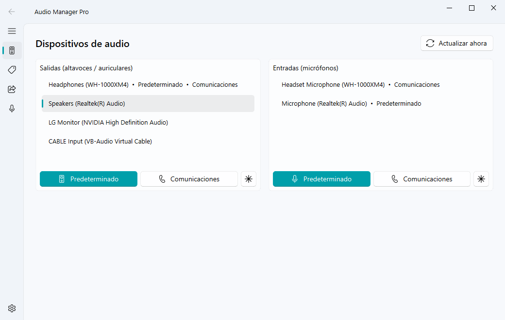
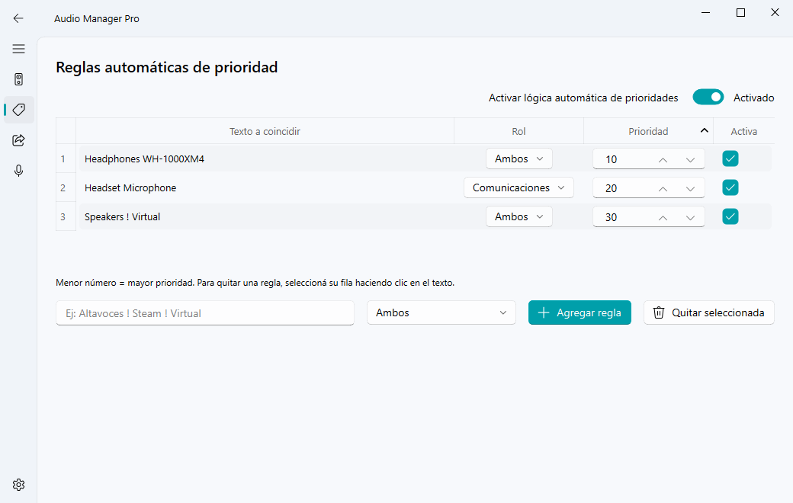
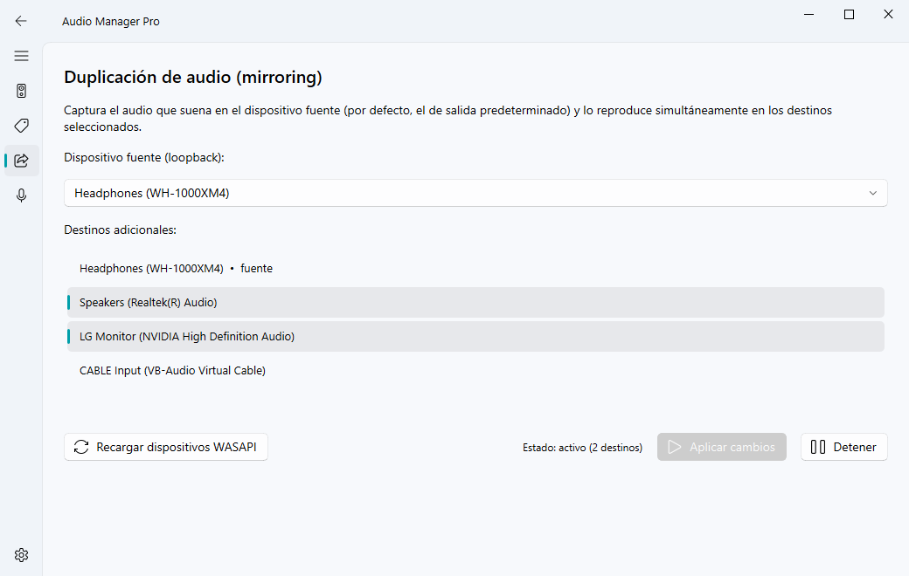
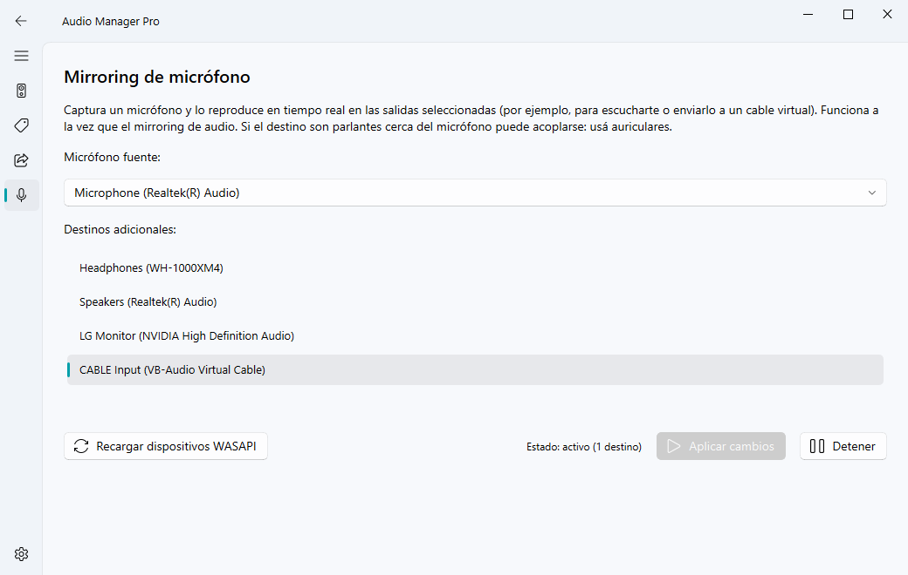
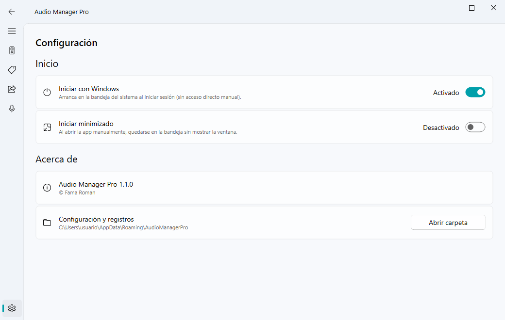
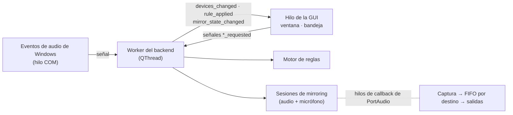

<div align="center">

# Audio Manager Pro

**Gestor inteligente de dispositivos de audio para Windows 10/11.**
Reglas automáticas de dispositivo predeterminado, mirroring de audio y de
micrófono en tiempo real y menú en la bandeja del sistema, con interfaz
Fluent Design nativa.

[](https://github.com/RomanFama592/audio-manager-pro/actions/workflows/ci.yml)
[](LICENSE)


[English](README.md) · **Español**



</div>

## Funcionalidades

- **Cambio de dispositivo predeterminado**: fija por separado el dispositivo
  *predeterminado* y el de *comunicaciones*, para salidas y micrófonos, con un
  clic (desde la ventana o la bandeja).
- **Reglas automáticas de prioridad**: por ejemplo, *"si se conectan mis
  auriculares Bluetooth, que pasen a ser el predeterminado; si se desconectan,
  volver a los altavoces"*. Reaccionan al instante al conectar/desconectar.
- **Mirroring de audio**: reproduce lo que suena en una salida en varias
  salidas a la vez (WASAPI loopback), con baja latencia.
- **Mirroring de micrófono**: envía un micrófono a una o más salidas
  (escucharte, alimentar un cable virtual…), en paralelo al mirroring de audio.
- **Bandeja del sistema**: menú rápido para forzar un dispositivo, activar las
  reglas, iniciar con Windows o salir.
- **Instalación correcta en Windows**: instalador por usuario (sin permisos de
  administrador), acceso en el menú Inicio, desinstalador e *Iniciar con
  Windows* sin accesos directos manuales.

<details>
<summary><b>Más capturas</b></summary>

| Reglas de prioridad | Mirroring de audio |
|---|---|
|  |  |
| **Mirroring de micrófono** | **Configuración** |
|  |  |

</details>

## Instalación

1. Descargá `AudioManagerPro-Setup-<versión>.exe` desde la
   [última versión](https://github.com/RomanFama592/audio-manager-pro/releases/latest).
2. Ejecutalo. Se instala para tu usuario en
   `%LOCALAPPDATA%\Programs\Audio Manager Pro`, sin pedir administrador.
   Dejá tildado **Iniciar con Windows** si la querés en la bandeja al iniciar sesión.

> [!IMPORTANT]
> El instalador no está firmado digitalmente, así que SmartScreen puede mostrar
> *"Windows protegió su PC"*. Hacé clic en **Más información → Ejecutar de todas formas**.

- **Actualizar:** ejecutá el instalador nuevo; cierra la app, la actualiza en
  su lugar y conserva tu configuración.
- **Desinstalar:** *Configuración → Aplicaciones → Aplicaciones instaladas →
  Audio Manager Pro*. Te pregunta si borrar también tus reglas y configuración.
- **Para todos los usuarios:** ejecutá el instalador con `/ALLUSERS` (requiere
  administrador) para instalar en *Archivos de programa*.

Requisitos: Windows 10 u 11 de 64 bits.

## Uso

### Dispositivos

Elegí un dispositivo y presioná **Predeterminado**, **Comunicaciones** o **✱**
(ambos). Windows mantiene dos predeterminados distintos: el *predeterminado* lo
usan la mayoría de las apps; el de *comunicaciones*, Discord, Teams, Zoom, etc.

### Reglas automáticas

Cada regla tiene un texto, un rol y una prioridad. Cada vez que cambian los
dispositivos, el dispositivo activo con **menor número de prioridad** que
coincide con una regla pasa a ser el predeterminado para el rol de esa regla.

| Texto | Coincide con dispositivos cuyo nombre… |
|---|---|
| `sony auriculares` | contiene **todas** las palabras, en cualquier orden |
| `Altavoces ! Steam` | contiene `altavoces` y **no** contiene `steam` |
| `! Virtual ! Steam` | no contiene ni `virtual` ni `steam` |

No distingue mayúsculas. Roles: **Ambos**, **Predeterminado** o
**Comunicaciones**; cada rol se decide por separado.

Un cambio manual se respeta: las reglas solo vuelven a cambiar el dispositivo
cuando cambia el "mejor" dispositivo según las reglas (al conectar o quitar
uno), cuando editás las reglas o cuando volvés a activar las reglas automáticas.

### Mirroring de audio

Elegí una **fuente** (por defecto, el dispositivo predeterminado actual) y uno o
más **destinos**, y presioná **Iniciar mirroring**. Mientras corre, el botón
pasa a **Aplicar cambios** y solo se habilita si cambiás la selección. La
fuente no puede ser destino (el audio volvería sobre sí mismo). Los destinos
con otro formato se convierten automáticamente.

### Mirroring de micrófono

Igual que el anterior, pero la fuente es un micrófono. Es independiente del
mirroring de audio, así que pueden estar activos los dos a la vez. Si un
destino son parlantes cerca del micrófono puede acoplarse: usá auriculares.

### Iniciar con Windows

Se activa en **Configuración** o en el menú de la bandeja. Se guarda en
`HKCU\Software\Microsoft\Windows\CurrentVersion\Run` (la misma entrada que crea
el instalador) y respeta el interruptor de *Configuración de Windows →
Aplicaciones → Inicio*.

### Línea de comandos

| Comando | Efecto |
|---|---|
| `AudioManagerPro.exe` | Abre la app; si ya está en la bandeja, muestra su ventana. |
| `AudioManagerPro.exe --minimized` | Arranca en la bandeja (lo usa *Iniciar con Windows*). |
| `AudioManagerPro.exe --quit` | Cierra la instancia en ejecución (lo usa el instalador). |

### Dónde se guardan los datos

`%APPDATA%\AudioManagerPro\` contiene `config.json` (reglas y preferencias) y
`app.log` (rota a 1 MB, guarda 3 copias). *Configuración → Abrir carpeta* la
abre. Si `config.json` está dañado, se renombra a `config.json.corrupt` y se
crea uno nuevo.

## Compilar desde el código fuente

Requisitos: Windows 10/11 x64, **Python 3.14** (la versión con la que están
probadas las dependencias fijadas) y, para el instalador,
[Inno Setup 6](https://jrsoftware.org/isinfo.php).

```powershell
git clone https://github.com/RomanFama592/audio-manager-pro.git
cd audio-manager-pro
python -m venv .venv
.venv\Scripts\python -m pip install -r requirements-dev.txt
.venv\Scripts\python main.py
```

Pruebas (reglas, configuración, buffer del mirroring, callbacks COM, inicio
automático):

```powershell
.venv\Scripts\python -m unittest discover -s tests -v
```

Compilar el ejecutable y el instalador:

```powershell
winget install JRSoftware.InnoSetup   # una sola vez
powershell -ExecutionPolicy Bypass -File .\build.ps1
```

`build.ps1` corre las pruebas, genera `dist\AudioManagerPro\` con PyInstaller
(modo carpeta) y crea `dist\installer\AudioManagerPro-Setup-<versión>.exe`.
Opciones: `-SkipTests`, `-SkipInstaller`.

### Publicar una versión nueva

1. Cambiá `__version__` en [`version.py`](version.py) (lo usan la app, las
   propiedades del `.exe` y el instalador) y actualizá
   [`CHANGELOG.md`](CHANGELOG.md).
2. Commiteá, creá el tag y pushealo: `git tag v1.2.0 && git push origin v1.2.0`.
3. El [workflow Release](.github/workflows/release.yml) compila el instalador y
   lo publica en GitHub Releases.

No cambies nunca el `AppId` de `installer/AudioManagerPro.iss`: es lo que
permite que una versión nueva actualice la instalación existente.

## Cómo funciona

```
audio_manager/
├── main.py                 Punto de entrada: argumentos, instancia única, bandeja, ventana
├── config.py               Persistencia de la configuración (JSON en %APPDATA%)
├── version.py              Versión única
├── core/                   Lógica de audio, sin Qt
│   ├── device_manager.py   Enumeración WASAPI, predeterminado (IPolicyConfig), eventos de hot-plug
│   ├── rules_engine.py     Evaluación de reglas de prioridad (por rol)
│   ├── mirror_engine.py    Captura loopback/micrófono → reproducción en varias salidas
│   └── autostart.py        Inicio con Windows (clave Run de HKCU)
├── ui/                     PySide6 + qfluentwidgets
│   ├── signals_bridge.py   Hilo del backend y sus señales Qt
│   ├── main_window.py      Páginas de dispositivos, reglas y mirroring
│   ├── settings_page.py    Página de configuración
│   ├── single_instance.py  Lock + socket local (mensajes "show" / "quit")
│   └── tray.py             Icono y menú de la bandeja
├── tests/                  Pruebas unitarias (no necesitan audio real)
├── installer/              Script de Inno Setup
├── AudioManagerPro.spec    Build de PyInstaller
└── build.ps1               Pruebas + PyInstaller + instalador
```



- **Hilos.** Todo el trabajo de audio y COM corre en un `QThread` dedicado. La
  GUI se comunica con él solo mediante señales Qt (conexiones encoladas). Las
  notificaciones de Windows llegan en hilos COM y solo emiten una señal; las
  ráfagas de eventos (un enchufe dispara 4–5 avisos) se agrupan en un único
  refresco.
- **Dispositivo predeterminado.** Windows no tiene una API pública para
  cambiarlo. Igual que EarTrumpet o SoundSwitch, la app usa la interfaz COM no
  documentada `IPolicyConfig` (`SetDefaultEndpoint`), estable desde Vista hasta
  Windows 11.
- **Mirroring.** La fuente se captura con
  [PyAudioWPatch](https://github.com/s0d3s/PyAudioWPatch) (WASAPI loopback o
  micrófono). Cada destino tiene su propio stream de salida de
  [sounddevice](https://python-sounddevice.readthedocs.io/) y su propio FIFO de
  muestras (colchón de ~40 ms, tope de 200 ms), así que los distintos tamaños de
  bloque, latencias y deriva de reloj no producen cortes, y un dispositivo lento
  no frena a los demás. Los callbacks de audio nunca toman locks compartidos con
  iniciar/detener. Los streams caídos se detectan cada 2 s y se informan.
- **Instancia única.** Un `QLockFile` más un `QLocalServer` con nombre por
  usuario: un segundo arranque le manda `show` (o `quit`) a la instancia en
  ejecución y termina.

## Solución de problemas

| Problema | Qué hacer |
|---|---|
| SmartScreen bloquea el instalador | *Más información → Ejecutar de todas formas* (no está firmado). |
| Un dispositivo recién conectado no aparece en el mirroring | Presioná **Recargar dispositivos WASAPI**. Mientras hay un mirroring activo la lista no se vuelve a escanear (lo interrumpiría). |
| La app se abrió dos veces al iniciar sesión | Borrá cualquier acceso directo viejo de `AudioManagerPro` en `shell:startup`; el instalador y la app usan el registro. |
| Las reglas no cambian el dispositivo | Verificá que las reglas automáticas estén activas, que la regla esté habilitada y que su texto coincida con el nombre que muestra la página *Dispositivos*. |
| Cualquier otra cosa | Abrí `%APPDATA%\AudioManagerPro\app.log` y [creá un issue](https://github.com/RomanFama592/audio-manager-pro/issues) adjuntándolo. |

## Limitaciones conocidas

- Las reglas solo se aplican a dispositivos de salida (todavía no hay reglas
  para micrófonos).
- `IPolicyConfig` no está documentada; una build futura de Windows podría cambiarla.
- La interfaz solo está en español.
- El instalador y el ejecutable no están firmados digitalmente.

## Contribuir

Los issues y pull requests son bienvenidos. Corré las pruebas antes de abrir un
PR (`python -m unittest discover -s tests`). Los comentarios del código y la
interfaz están en español.

## Licencia

Audio Manager Pro se distribuye bajo la
[Licencia Pública General de GNU v3.0](LICENSE).

Está construido sobre estos proyectos de código abierto:

| Proyecto | Licencia |
|---|---|
| [PySide6-Fluent-Widgets](https://github.com/zhiyiYo/PyQt-Fluent-Widgets) (qfluentwidgets) | GPL-3.0 |
| [PySide6 / Qt for Python](https://doc.qt.io/qtforpython-6/) | LGPL-3.0 |
| [PySideSix-Frameless-Window](https://github.com/zhiyiYo/PyQt-Frameless-Window) | LGPL-3.0 |
| [PyAudioWPatch](https://github.com/s0d3s/PyAudioWPatch) | Apache-2.0 |
| [sounddevice](https://github.com/spatialaudio/python-sounddevice) | MIT |
| [pycaw](https://github.com/AndreMiras/pycaw) · [comtypes](https://github.com/enthought/comtypes) | MIT |
| [NumPy](https://numpy.org/) | BSD-3-Clause |
