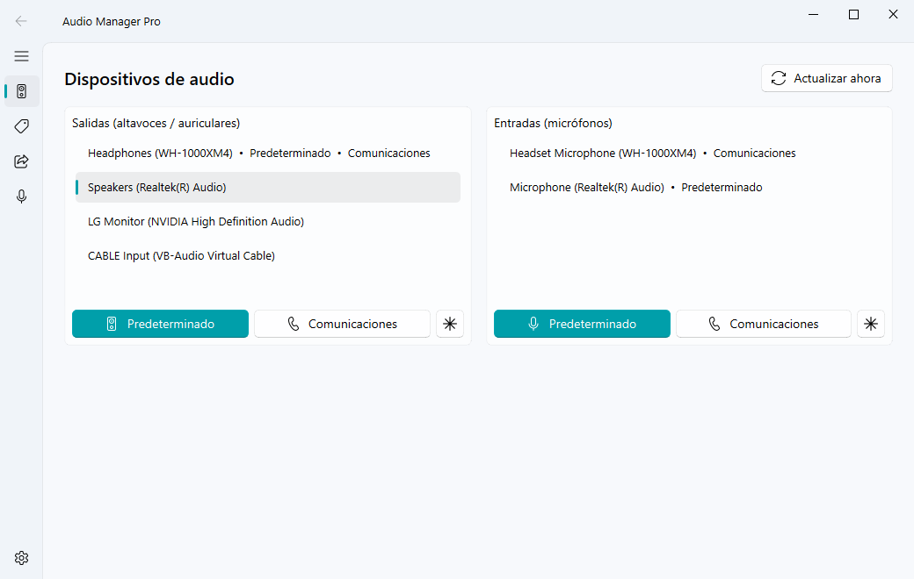
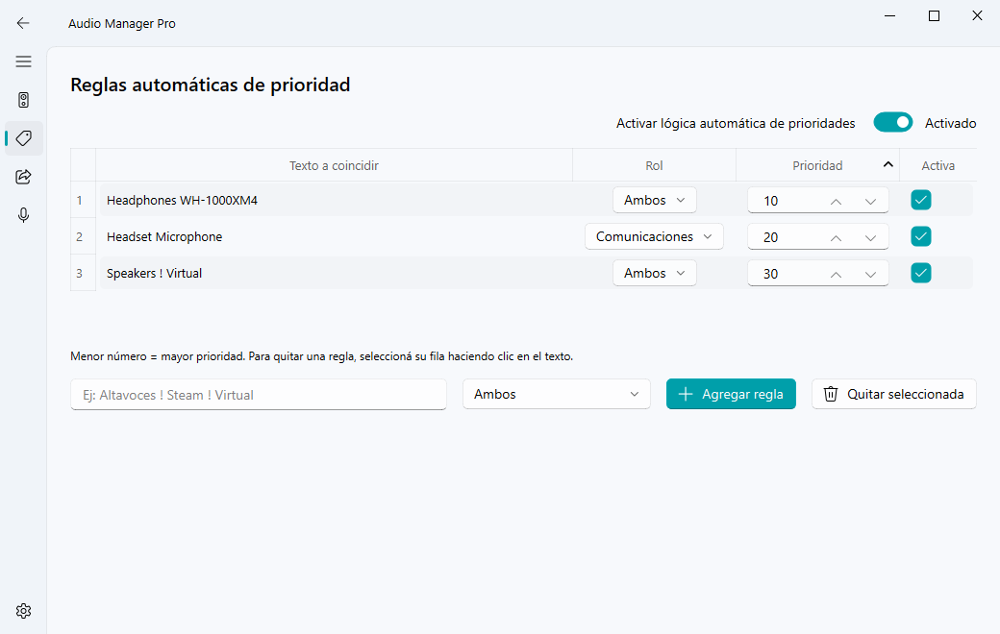
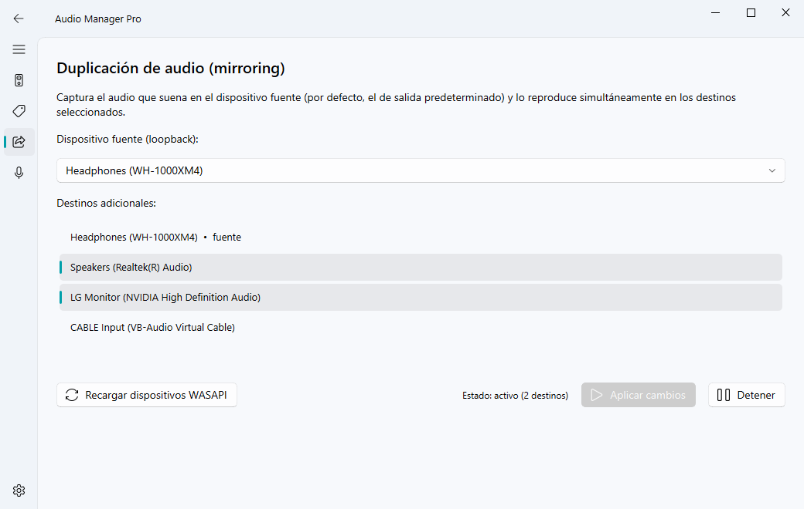
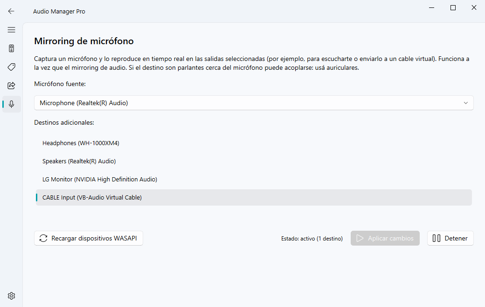
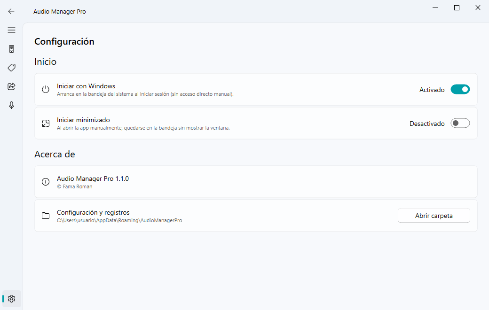
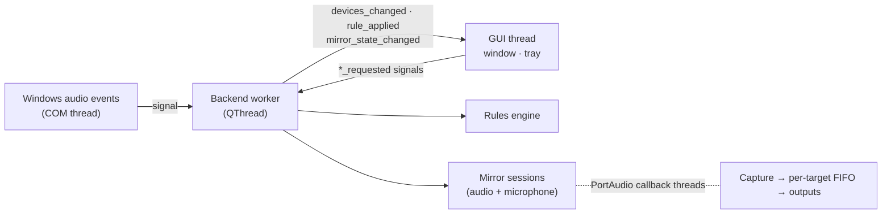

<div align="center">

# Audio Manager Pro

**Smart audio device manager for Windows 10/11.**
Automatic default-device rules, real-time audio and microphone mirroring,
and a system-tray menu — with a native Fluent Design interface.

[](https://github.com/RomanFama592/audio-manager-pro/actions/workflows/ci.yml)
[](LICENSE)


**English** · [Español](README.es.md)



</div>

> [!NOTE]
> The user interface is currently in Spanish.

## Features

- **Default device switching** — set the *default* and *communications* device
  independently, for outputs and microphones, in one click (window or tray).
- **Automatic priority rules** — e.g. *"when my Bluetooth headphones connect,
  make them the default; when they disconnect, go back to the speakers"*.
  Rules react instantly to plug/unplug events.
- **Audio mirroring** — play whatever sounds on one output on several other
  outputs at the same time (WASAPI loopback), with low latency.
- **Microphone mirroring** — route a microphone to one or more outputs
  (monitor yourself, feed a virtual cable…), in parallel with audio mirroring.
- **System tray** — quick menu to force a device, toggle the rules, start with
  Windows, or quit.
- **Proper Windows install** — per-user installer (no admin rights), Start menu
  entry, uninstaller, and *Start with Windows* without manual shortcuts.

<details>
<summary><b>More screenshots</b></summary>

| Priority rules | Audio mirroring |
|---|---|
|  |  |
| **Microphone mirroring** | **Settings** |
|  |  |

</details>

## Installation

1. Download `AudioManagerPro-Setup-<version>.exe` from the
   [latest release](https://github.com/RomanFama592/audio-manager-pro/releases/latest).
2. Run it. It installs for the current user in
   `%LOCALAPPDATA%\Programs\Audio Manager Pro` — no administrator rights needed.
   Keep **Start with Windows** checked if you want it in the tray at sign-in.

> [!IMPORTANT]
> The installer is not code-signed, so Windows SmartScreen may show
> *"Windows protected your PC"*. Click **More info → Run anyway**.

- **Update:** run the newer installer; it closes the running app, updates it
  in place and keeps your settings.
- **Uninstall:** *Settings → Apps → Installed apps → Audio Manager Pro*. You
  will be asked whether to also delete your settings and rules.
- **All users:** run the installer with `/ALLUSERS` (requires admin) to
  install in *Program Files*.

Requirements: Windows 10 or 11, 64-bit.

## Usage

### Devices

Select a device and press **Predeterminado** (default), **Comunicaciones**
(communications) or **✱** (both). Windows keeps two separate defaults:
*default* is used by most apps; *communications* by Discord, Teams, Zoom, etc.

### Automatic rules

Each rule has a match text, a role and a priority. Whenever devices change,
the active device with the **lowest priority number** that matches a rule
becomes the default for that rule's role.

| Match text | Matches devices whose name… |
|---|---|
| `sony headphones` | contains **all** the words, in any order |
| `Speakers ! Steam` | contains `speakers` and **not** `steam` |
| `! Virtual ! Steam` | contains neither `virtual` nor `steam` |

Matching is case-insensitive. Roles: **Ambos** (both), **Predeterminado**
(default only) or **Comunicaciones** (communications only); each role is
decided independently.

A manual change is respected: rules only switch devices again when the "best"
matching device changes (e.g. a device is plugged in or removed), when you
edit the rules, or when you turn automatic rules back on.

### Audio mirroring

Choose a **source** output (defaults to the current default device) and one or
more **targets**, then press **Iniciar mirroring**. While it runs, the button
becomes **Aplicar cambios** (apply changes) and is only enabled when you change
the selection. The source cannot be a target (that would loop the audio back
into itself). Targets with a different format are converted automatically.

### Microphone mirroring

Same as above, but the source is a microphone. It runs independently of audio
mirroring, so both can be active at the same time. If a target is a speaker
near the microphone you may get acoustic feedback — use headphones.

### Start with Windows

Toggle it in **Configuración** (settings) or in the tray menu. It is stored in
`HKCU\Software\Microsoft\Windows\CurrentVersion\Run` (the same entry the
installer creates) and respects the switch in Windows *Settings → Apps →
Startup*.

### Command line

| Command | Effect |
|---|---|
| `AudioManagerPro.exe` | Opens the app, or shows the window if it is already running in the tray. |
| `AudioManagerPro.exe --minimized` | Starts in the tray (used by *Start with Windows*). |
| `AudioManagerPro.exe --quit` | Closes the running instance (used by the installer). |

### Where data is stored

`%APPDATA%\AudioManagerPro\` contains `config.json` (rules and preferences) and
`app.log` (rotates at 1 MB, 3 backups). *Configuración → Abrir carpeta* opens it.
If `config.json` is corrupt, it is renamed to `config.json.corrupt` and a fresh
one is created.

## Building from source

Requirements: Windows 10/11 x64, **Python 3.14** (the version the pinned
dependencies are tested with) and, for the installer,
[Inno Setup 6](https://jrsoftware.org/isinfo.php).

```powershell
git clone https://github.com/RomanFama592/audio-manager-pro.git
cd audio-manager-pro
python -m venv .venv
.venv\Scripts\python -m pip install -r requirements-dev.txt
.venv\Scripts\python main.py
```

Run the tests (rules, config, mirroring buffer, COM callbacks, autostart):

```powershell
.venv\Scripts\python -m unittest discover -s tests -v
```

Build the executable and the installer:

```powershell
winget install JRSoftware.InnoSetup   # once
powershell -ExecutionPolicy Bypass -File .\build.ps1
```

`build.ps1` runs the tests, builds `dist\AudioManagerPro\` with PyInstaller
(folder mode) and creates `dist\installer\AudioManagerPro-Setup-<version>.exe`.
Options: `-SkipTests`, `-SkipInstaller`.

### Releasing a new version

1. Bump `__version__` in [`version.py`](version.py) — it is used by the app,
   the `.exe` file properties and the installer — and update
   [`CHANGELOG.md`](CHANGELOG.md).
2. Commit, then tag and push: `git tag v1.2.0 && git push origin v1.2.0`.
3. The [Release workflow](.github/workflows/release.yml) builds the installer
   and publishes it on GitHub Releases.

Never change the `AppId` in `installer/AudioManagerPro.iss`: it is what lets
new versions update the existing installation.

## How it works

```
audio_manager/
├── main.py                 Entry point: CLI flags, single instance, tray, window
├── config.py               Settings persistence (JSON in %APPDATA%)
├── version.py              Single source of the version
├── core/                   Audio logic, no Qt
│   ├── device_manager.py   WASAPI enumeration, default device (IPolicyConfig), hot-plug events
│   ├── rules_engine.py     Priority rules evaluation (per role)
│   ├── mirror_engine.py    Loopback/microphone capture → multi-output playback
│   └── autostart.py        Start with Windows (HKCU Run key)
├── ui/                     PySide6 + qfluentwidgets
│   ├── signals_bridge.py   Backend worker thread and its Qt signals
│   ├── main_window.py      Devices, rules and mirroring pages
│   ├── settings_page.py    Settings page
│   ├── single_instance.py  Lock + local socket ("show" / "quit" messages)
│   └── tray.py             System tray icon and menu
├── tests/                  Unit tests (no real audio needed)
├── installer/              Inno Setup script
├── AudioManagerPro.spec    PyInstaller build
└── build.ps1               Tests + PyInstaller + installer
```



- **Threading.** All audio and COM work runs on a dedicated backend `QThread`.
  The GUI talks to it only through Qt signals (queued connections). Windows
  device notifications arrive on COM threads and only emit a signal; bursts of
  events (one plug-in fires 4–5 notifications) are debounced into one refresh.
- **Default device.** Windows has no public API to change the default device.
  Like EarTrumpet or SoundSwitch, the app uses the undocumented `IPolicyConfig`
  COM interface (`SetDefaultEndpoint`), stable from Vista to Windows 11.
- **Mirroring.** The source is captured with
  [PyAudioWPatch](https://github.com/s0d3s/PyAudioWPatch) (WASAPI loopback or a
  microphone). Each target gets its own [sounddevice](https://python-sounddevice.readthedocs.io/)
  output stream and its own sample FIFO (~40 ms jitter buffer, 200 ms cap), so
  different block sizes, latencies and clock drift don't cause glitches and a
  slow device never blocks the others. Audio callbacks never take locks shared
  with start/stop. Dead streams are detected every 2 s and reported.
- **Single instance.** A `QLockFile` plus a `QLocalServer` named per user: a
  second launch sends `show` (or `quit`) to the running instance and exits.

## Troubleshooting

| Problem | What to do |
|---|---|
| SmartScreen blocks the installer | *More info → Run anyway* (the installer is not signed). |
| A newly connected device is missing in mirroring | Press **Recargar dispositivos WASAPI**. While a mirroring session is running, the list is not re-scanned (that would interrupt it). |
| The app opened twice at sign-in | Remove any old `AudioManagerPro` shortcut from `shell:startup`; the installer and the app use the registry instead. |
| Rules don't switch the device | Check that automatic rules are on, the rule is enabled and its text matches the device name shown on the *Dispositivos* page. |
| Anything else | Open `%APPDATA%\AudioManagerPro\app.log` and [open an issue](https://github.com/RomanFama592/audio-manager-pro/issues) with it. |

## Known limitations

- Rules only apply to output devices (microphone rules are not implemented yet).
- `IPolicyConfig` is undocumented; a future Windows build could change it.
- The interface is only available in Spanish.
- The installer and executable are not code-signed.

## Contributing

Issues and pull requests are welcome. Please run the tests before opening a PR
(`python -m unittest discover -s tests`). Code comments and the UI are in
Spanish; English is fine for issues and PRs.

## License

Audio Manager Pro is released under the [GNU General Public License v3.0](LICENSE).

It is built on top of these open-source projects:

| Project | License |
|---|---|
| [PySide6-Fluent-Widgets](https://github.com/zhiyiYo/PyQt-Fluent-Widgets) (qfluentwidgets) | GPL-3.0 |
| [PySide6 / Qt for Python](https://doc.qt.io/qtforpython-6/) | LGPL-3.0 |
| [PySideSix-Frameless-Window](https://github.com/zhiyiYo/PyQt-Frameless-Window) | LGPL-3.0 |
| [PyAudioWPatch](https://github.com/s0d3s/PyAudioWPatch) | Apache-2.0 |
| [sounddevice](https://github.com/spatialaudio/python-sounddevice) | MIT |
| [pycaw](https://github.com/AndreMiras/pycaw) · [comtypes](https://github.com/enthought/comtypes) | MIT |
| [NumPy](https://numpy.org/) | BSD-3-Clause |
